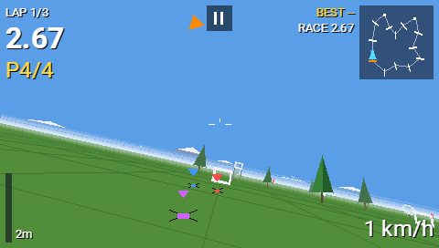
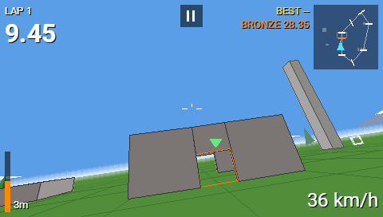
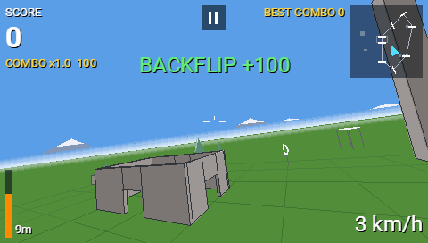
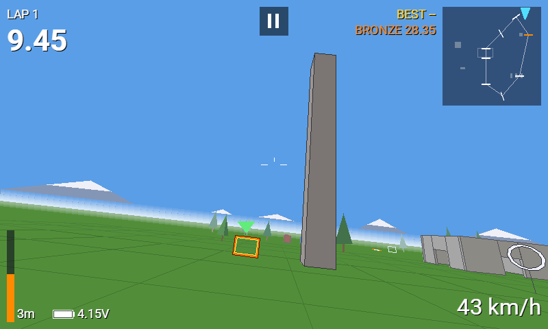
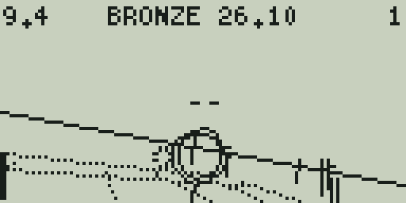
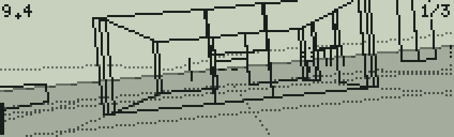
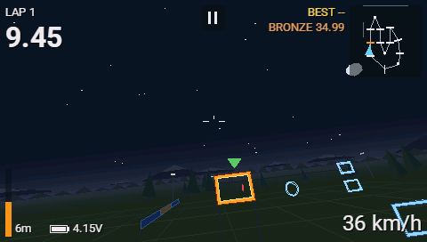
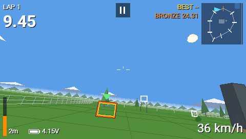
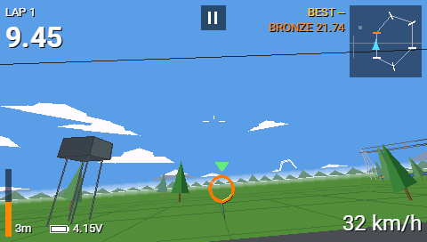
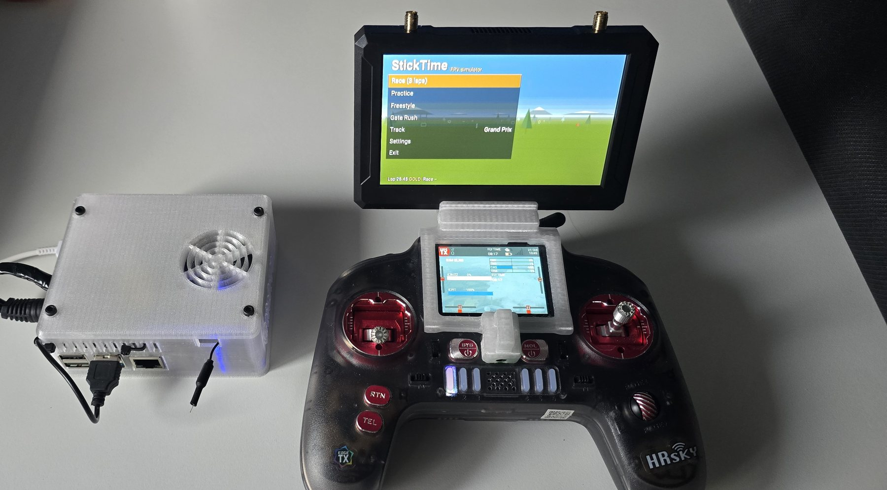

#  StickTime

A real 3D FPV quad simulator that runs **on your radio** as an EdgeTX Lua tool. Race AI pilots, fly freestyle around a bando or chase gates against the clock, with nothing but your radio. Color screens get filled 3D, black & white radios get wireframe 3D, and older B&W radios with little memory get **StickTime Lite**.

**[Play it in your browser](https://juricabi.github.io/sticktime/)** · **[Download for your radio](https://github.com/juricabi/sticktime/releases/latest)** · EdgeTX 2.11 or newer (the color version also runs on older EdgeTX) · free software, GPL-2.0

| TX16S · race against AI pilots | TX16S · the Bando | TX16S · freestyle |
|---|---|---|
|  |  |  |
| **TX16S MK3 (800×480) · tower and dive gate** | **TX12 MkII (128×64) · StickTime BW** | **X9D (212×64 grey) · StickTime Lite** |
|  |  |  |
| **TX16S · Night on the Pro Track** | **TX16S · Farm Field (gallery)** | **TX16S · Power Line (gallery)** |
|  |  |  |

## In your goggles: StickTime Pi

No radio screen needed: **[StickTime Pi](https://github.com/juricabi/sticktime-pi)** runs this same game on a
Raspberry Pi and sends the picture to your **analog FPV goggles** through a 5.8 GHz VTX (or over HDMI), while your
radio flies it as an ExpressLRS / Crossfire WiFi joystick, over USB or Bluetooth. A flashable SD card image, a
web page for the settings, VTX control over SmartAudio or Tramp, and the same tracks and editor as here.



## Install

Download `StickTime-<version>-sdcard.zip` from the [latest release](https://github.com/juricabi/sticktime/releases/latest), copy what your radio needs from its `SCRIPTS/TOOLS/` to `/SCRIPTS/TOOLS/` on the SD card, and start it from **SYS → Tools**. Or let the [emulator](https://juricabi.github.io/sticktime/) do it (Chrome or Edge on a computer, the radio plugged in by USB in USB Storage mode): **Install** → **Connect radio** → **Install / update**; it also updates an older version and leaves your saves, tracks and ghosts alone.

| Radio | Copy | EdgeTX |
|---|---|---|
| Any color screen (TX16S / MkII / MK3, TX15, GX15, T15, T16, T18, X10, X12S, V12, V16, NV14, EL18, PL18, PA01, ...) | `StickTime.lua`, `StickTimeGhosts/`, `StickTimeTracks/` | 2.11+, older works too |
| B&W with an STM32F4 (TX12 MkII, Zorro, Boxer, Pocket, MT12, GX12, X9D+ 2019, X9E, X7 ACCESS, T14, T20, ...) | `StickTimeBW.lua`, `StickTimeBW/`, `StickTimeTracks/` | 2.11+ |
| Older B&W, STM32F2 (TX12 MkI, X7, X9D, X9D+, X9 Lite, X-Lite, T12, T8, ...) | `StickTimeLite.lua`, `StickTimeLite/` | 2.11 (their last) |

- **Updating:** replace the `StickTimeBW` folder whole; replace `StickTimeLite` but keep its `data.txt` (your Lite saves). Install does both for you.
- **Your own tracks** go in `StickTimeTracks/` as `c1.txt` to `c8.txt` (tracks 9-16, color and BW; a bigger track needs StickTime 1.8.0 or later on a color radio, a track with scenery 1.10.0 or later). Restart the game after adding one. The [track gallery](tracks/) has more to fly, the MultiGP qualifier tracks of 2017 to 2026 among them.
- The B&W versions need EdgeTX 2.11 ("Needs EdgeTX 2.11 or newer" on older). They also run on color radios, in B&W style.

> **Safety:** the radio keeps transmitting your sticks while the sim runs. Unplug the quad's battery or switch the RF module off first.

## Features

- **Flight model:** each quad class fitted to a detailed per-prop model (within 0.2-0.5 m/s in steady flight): Betaflight-style throttle curves, thrust loss climbing, translational lift, a cushion when you drop, ground effect, frame downforce, the airmode mixer in flips, 6 ms motors, 80 Hz physics. Details in [docs/flight-model.md](docs/flight-model.md).
- **Quads:** Racer 5", Freestyle 5", 3" toothpick, Whoop 65mm, Whoop 75mm; Power Stock or the range quads of their kind have; Acro or Angle. **Rates:** Betaflight Actual (Soft, Normal, Fast or Custom, in Betaflight's own steps).
- **Tracks:** Meadow, Figure 8, Dive Tower, Slalom, Hoop Forest, Grand Prix, the Bando (an open-roof ruin with a 36 m tower) and Pro Track, with gates, high gates, dive gates, hoops, arches, flags and gaps in walls; plus 8 of your own from the emulator's track editor or the [track gallery](tracks/): up to 24 gates and 16 structures on color and B&W radios, or up to 48 gates and 64 structures on color radios (StickTime 1.8.0 and later).
- **Scenery** (color screens, StickTime 1.10.0 and later): props (conifers, leafy trees, bushes, hay bales, tyre stacks, traffic cones, light masts, tents, windsocks, posts), rails between two points (fences, safety nets, race tape, power lines on pylons, banners), the ground's decals (dirt roads, tarmac, gravel, painted lines, ponds, sand) and structures in wood, brick, dark steel, white, yellow and green. The eight tracks have their own, such as Meadow's hay bales and pond, a car park round Figure 8 and the Grand Prix's tarmac start straight with tents and banners. Every track has a pilots' area by the start pad, a tent and a **windsock** that shows the wind and its gusts. Fences, nets, banners, race tape and the wires stop the quad like a wall (a hard hit edge-on is a prop strike), landing in a pond is a **SPLASH**. Your own tracks get all of it too (up to 32 props, 12 rails and 8 decals, or 128, 32 and 32 in a bigger track). B&W radios have no memory for the scenery: they fly such a track's gates and structures.
- **Modes:** **Race** up to 3 AI pilots (Easy, Medium, Hard) · **Practice** against your best, with a **ghost** of your fastest lap (color edition) · **Freestyle** tricks and combos (UNDER: beneath a power line or banner) · **Gate Rush** against the clock.
- **Medals:** Gold, Silver and Bronze are the Hard, Medium and Easy AI's lap at the Power you fly; shown in the menu, the Practice OSD and the results.
- **Hits:** the quad stops against what it hits and flies on. A hard hit edge-on is a prop strike: half a second of tumbling to fly out of. Upside down on the ground: **turtle mode**, roll or pitch to flip back. **Pause → Respawn** puts you at the last gate.
- **Battery** (Off, Real, 1.5x, 2x): each class's real pack sags and runs down (about 2 min of hard racing on a 5"); a fresh pack flies exactly like no battery. Beeps and a yellow/red battery below 3.5 / 3.3 V a cell, then EMPTY and a fresh pack. Respawn also brings a fresh pack.
- **Also:** wind with gusts, prop wash (Off, Stock, Max), Grip (rotor drag), vibration on hits and laps. On color screens the marker over the next gate shows where to come in from, a guide on a track you're learning: green on its way-in side (within 70° of its axis) or heading straight into it, yellow when you need to go round (a dive gate: green above it; a flag: before it, on or heading to the side you pass it).
- **Colors** (color screens, StickTime 1.9.0 and later): Classic, or a natural sky that fades into the haze at the horizon over duller grass, with calmer object and text colors: **Summer**, **Evening** or **Overcast**, and **Night** (1.10.0): stars, the moon, LED gates. Kinder to the eyes in FPV goggles, and clean on analog video (it carries detail in brightness, not color). **Auto** is Classic on a radio and Summer on [StickTime Pi](https://github.com/juricabi/sticktime-pi)'s analog video output. **Sky detail** (1.10.0, On by default) draws clouds drifting slowly round, the sun (low and orange in the Evening), and at Night the moon and stars; under 1 ms a frame on a TX16S, and off in a moment on a slow radio. StickTime BW draws a ridge of mountains on the horizon.
- **Saving:** bests and the ghost are saved the moment you set them, so switching the radio off keeps them. (A lap that sets a new ghost writes a 5 KB file, which can pause the radio for a moment; races never write a ghost.)

| What each edition has | Color | BW | Lite |
|---|---|---|---|
| Flight model, the five quads, prop wash, Grip, wind | yes | yes | yes |
| The eight tracks (1.7.0 layouts) | yes | yes | yes |
| Practice, Freestyle, Gate Rush | yes | yes | yes |
| Race against AI pilots | yes | yes | no (Time trial instead) |
| Custom rates | yes | yes | no (Soft, Normal, Fast) |
| Hits without respawn, prop strikes, turtle mode, Respawn | yes | yes | no (a hit is a crash) |
| Medals | yes (menu, Practice OSD, results) | yes (Practice OSD, results; menu only on 212×64) | no |
| Battery | yes (battery icon and cell voltage; flight time, mAh and pack voltage when paused) | yes (cell voltage and gauge, LAND below 3.3 V; flight time and mAh when paused) | no |
| Your own tracks 9-16 | yes | yes | no |
| Bigger tracks of your own (up to 48 gates, 64 structures) | yes | no (24 gates, 16 structures) | no |
| Scenery: props, rails, decals, structure colors; on the eight tracks and your own | yes | no (no memory for it: a track of your own with scenery flies with its gates and structures) | no |
| The start pad, a windsock, mountains on the horizon | yes | yes (in lines) | the pad and the windsock (in lines) |
| Ghost | yes | no (not enough memory on B&W radios) | no |
| Minimap, stick view, touch | yes | no | no |
| Colors: Classic, Summer, Evening, Overcast, Night; Sky detail | yes | no (B&W) | no (B&W) |
| The next gate's marker turns green where you can come in from | yes | no | no |

| Files in `/SCRIPTS/TOOLS/` | |
|---|---|
| `StickTime.lua` · `StickTimeBW.lua`, `StickTimeBW/` · `StickTimeLite.lua`, `StickTimeLite/` | the three editions; saves in `StickTime.dat`, `StickTimeBW.dat`, `StickTimeLite/data.txt` |
| `StickTimeTracks/c1.txt` … `c8.txt` | your tracks 9 to 16 |
| `StickTimeGhosts/c1.txt` … `c16.txt` | ghosts, by track number (delete one to forget it) |

## Controls

| | |
|---|---|
| Sticks | fly (the radio applies your stick mode) |
| ENTER | select; on a setting, edit it with the wheel or +/- |
| EXIT | pause (Resume, Respawn, Restart, Settings, Main menu), back, quit; long EXIT closes the tool on color radios |
| Touch | tap rows and setting halves; the pause button is at the top |

## Screens

480×272 (TX16S, X10, X12S, T16, T18, V16), 480×320 (TX15, GX15, T15, PL18), 320×480 portrait (NV14, EL18), 320×240 (PA01, V12), 800×480 (TX16S MK3), 212×64 grey (X9D+ 2019, X9E; X9D, X9D+ with the Lite) and 128×64. The layout follows the screen size and fonts, so new sizes work too.

## Faster firmware (optional)

Stock EdgeTX runs a tool at most every 50 ms (20 fps) and shows each frame a cycle late. The [`fast-lua-20ms` prerelease](https://github.com/juricabi/edgetx/releases/tag/fast-lua-20ms) (EdgeTX `main` plus [`firmware/edgetx-fast-lua.patch`](firmware/edgetx-fast-lua.patch)) runs Lua tools every 20 ms with each frame going straight to the display and much faster drawing, for every color radio (`tx16s` for the TX16S and MkII, `tx16smk3` for the MK3). On the V12 that makes up to 50 fps and about 40 ms stick-to-screen. Test builds: back up your SD card first.

<details>
<summary>What the patch changes</summary>

While a Lua tool is open:

- the UI loop runs every 20 ms instead of 50 ms, and goes back to 50 ms when the tool closes;
- the tool draws into frames of its own and each finished frame goes straight to the display (a frame buffer swap at the vertical blank, or the SPI transfer), instead of LVGL drawing the tool's canvas into its own frame buffers every frame. Where the radio has the memory for it (at least 1 MB of heap left free) there are three: one on the display, one on its way there, one being drawn, so the tool doesn't wait for the display either. Radios whose panel is mounted upside down (TX16S, T16, X10, X10 Express, H17, older F16) show the tool's frame with a callback of their own, turned around into the back buffer: one full-screen pass per frame instead of three. Elsewhere each frame goes to the screen as soon as the script has drawn it (`lv_refr_now`), not at the next cycle;
- LVGL takes the display back whenever anything shows over the tool (a dialog, a message bubble, the power-off screen) and draws the whole screen again;
- solid lines, rectangles and filled triangles go straight into the tool's frame, instead of through an LVGL canvas call per shape (per row of a filled triangle), which is what made the Bando slow; large fills use the DMA2D;
- H7 radios no longer flush the whole data cache on every `lcd.drawLine`, only when the DMA2D has written memory since;
- the tool gets `TOOL_RUN_US` and `TOOL_SHOW_US`: how long its last `run()` and putting that frame on the screen took.

On the STM32H750 radios (every target linked with `stm32h750_sdram`: tx16smk3, tx15, gx15, t15pro, t15h7, t22, pa01, st16, c14, h17, v12, v15), whose firmware runs from SDRAM through a 16 KB instruction cache, the Lua interpreter and the drawing code behind the `lcd` functions run from the H750's 64 KB ITCM, which stock EdgeTX leaves empty, compiled for speed (about 49 KB of it). The STM32F429 radios have no ITCM, and need it less: their firmware runs from internal flash.

On the HelloRadioSky V12 and the Flysky PA01 (320×240 SPI screens) frames also go out in the background: the screen's vertical blank (FMARK) starts the SPI transfer and its interrupt finishes it, while the CPU already runs the next frame. On the V12 the DMA reads two pixels at a time from SDRAM, so a frame takes 13 ms on the SPI, inside one refresh of its 74 Hz panel (one pixel at a time took 14.5 ms, so every frame took two refreshes); the PA01's 50 MHz SPI takes about 25 ms. The PA01 has not been tried on a real radio yet.

The mixer task (sticks, mixes, RF, telemetry) keeps its higher priority and is not touched. `tools/build_firmware.sh v12` clones EdgeTX `main`, applies the patch and builds one radio's firmware (any target from EdgeTX's `tools/build-common.sh`, ARM GCC 14.2 on the `PATH`). The same changes are on the `fast-lua-20ms` branch of [juricabi/edgetx](https://github.com/juricabi/edgetx/tree/fast-lua-20ms), whose CI publishes the prerelease.

The script is ready for any frame rate: physics runs in 80 Hz substeps on the measured frame time (the tests fly every track at 50, 20 and 16 ms per frame, and lap times agree within a few tenths), the 10 ms `getTime()` steps are smoothed, and the camera is drawn ahead by the measured display delay. To set that delay by hand, set the global `STICKTIME_LAT` in seconds (`0` turns the prediction off). A host that knows when each frame reaches its display (StickTime Pi) sets `STICKTIME_DT` before each `run()` to that interval in ms, and the color game steps the simulation by it: from 10 ms ticks, 60 Hz frames step 0.6 ms unevenly on average and at times 3 ms (the tests check the steps stay within 0.25 ms). `STICKTIME_AV = true` says the picture goes to analog video: the HUD text gets a black outline instead of the drop shadow, and Colors Auto is Summer.
</details>

## Browser emulator

Play at **[juricabi.github.io/sticktime](https://juricabi.github.io/sticktime/)**, or open `web/simulator.html` (one file, works offline). It runs the real `.lua` files in a Lua 5.3 VM with an EdgeTX-style API, drawn pixel by pixel like the firmware.

- Any radio screen or a **PC screen** (1280×720, 1920×1080 at 60 fps); keyboard, on-screen gimbals or your radio as a USB joystick.
- Synthesized motor sound tuned against real quads, and live-composed music (or your own songs).
- **Tracks:** the track editor. Lay out gates, hoops, flags, dive gates, structures, walls and the scenery (props, rails and decals, or a pilots' area, a taped lane or a fence round the track in one go) on a map. **Open** picks a track to edit: one of yours, a new one, a file or one from the gallery of [tracks/](tracks/). The editor works on a copy: **To slot** picks c1 to c8, **Send to emulator** or **Send to radio** (Chrome/Edge, radio in USB Storage mode) puts it in that slot, **Fly c1** flies the emulator's slot, and **Save file** downloads it as `c1.txt`. A track with more than 24 gates, 16 structures or 999 bytes is saved as a bigger track (format 2). Only StickTime 1.8.0 or later on a color radio flies it. A track with scenery is saved as format 3 (StickTime 1.10.0 or later; StickTime BW flies its gates and structures), or format 4 when it's bigger (color radios). Many structures in view at once slow a radio down, so check **Radio load**. **My tracks** shows the emulator's and the radio's slots side by side: remove a track, or copy it from one to the other. Made a good one? [Add it](tracks/README.md#add-your-track) with a pull request.
- **Install:** connect the radio's SD card (Chrome or Edge on a computer) to install or update StickTime (hosted site only), and where to get the faster firmware. The tracks on the radio are under **Tracks** → **My tracks**.
- **Radio load** estimates the frame time on F2, F4 and H7 radios; **Open .lua** runs any EdgeTX tool script.

## Under the hood

<details>
<summary>Memory on B&W radios</summary>

B&W radios have no external RAM, and compiling a script on the radio takes far more memory than running it. So both B&W versions ship precompiled: `game.luac` is EdgeTX's Lua 5.3 bytecode (made by EdgeTX's own Lua), and `StickTimeBW.lua` / `StickTimeLite.lua` are small loaders that load only that. Compiling on the radio would need about 200 KB for StickTime BW and 135 KB for the Lite, more than any B&W radio has, and running out of memory can crash the radio. That is also why the binary is not called `core.luac` next to its source `core.lua`: EdgeTX compiles `x.lua` instead of loading `x.luac` whenever the source's file time is newer, which a copy that does not keep file times can cause. EdgeTX 2.10 and older use Lua 5.2 and can't load the bytecode: hence EdgeTX 2.11+. A Lua 5.2 build would not get StickTime BW onto them either: on 2.10's Lua it needs about 110 KB of heap, and 2.10 doesn't give STM32F4 radios the CCM pool that 2.11 added for Lua (`tools/build_etxhost.sh v2.10.7` builds 2.10's Lua for the memory test). When the game can't load (EdgeTX too old, too little memory, the folder missing), `why.lua` in the game's folder says what to do on a screen of its own (EdgeTX's error box would show a 128×64 radio only the end of a long message); it is a file of its own so that its code is not in memory while the game loads.

Measured on EdgeTX 2.11's own Lua core (the tests also run main's, which packs values tighter and needs about 10% less) with a model of the radio's allocator (newlib-nano malloc with its fragmentation, EdgeTX's small-block pools or CCM pool), loading through the loader and playing every track and mode:

| | Heap for Lua (EdgeTX 2.11.4) | Lua memory while playing | Peak heap use |
|---|---|---|---|
| StickTime BW on STM32F4 | 114–121 KB + 34 KB CCM | about 108 KB | 108 KB + 34 KB CCM (105 without a format 3 track of your own) |
| StickTime Lite on STM32F2 | 63–73 KB + 10 KB pools | about 53 KB | 60 KB + 10 KB pools |

The Lite runs on a heap down to 61.6 KB on EdgeTX 2.11.4, so about 1.7 KB of an X9D+ stays free (the memory test passes on every heap from there up, with no emergency garbage collection; 1.9.0 ran down to 61.0 KB there). That is also why the Lite has the start pad and a windsock but no mountains on its horizon, and StickTime BW no scenery: the code for them didn't fit. Its quads and tracks are files in its folder (`StickTimeLite/q1.txt` to `q5.txt`, `t1.txt` to `t8.txt`), read only when you pick one; it parses numbers without making a string for each, collects garbage before it builds a track and before the flight starts, and writes its save file piece by piece. The loaders collect what compiling them left behind before they load the game, and keep their error screen in `why.lua`, so the game loads into a clean heap.
</details>

<details>
<summary>How it stays fast on a radio</summary>

- **Fills.** Sky and ground are one rectangle plus one thin wedge triangle at any roll. Walls and structures are two filled triangles per face, filled row by row in C by the firmware. Upright bars and hoop segments are 1 px "ruled" lines. Faces cut by the near plane go through a polygon clipper.
- **Lua side.** World data lives in arrays of numbers, hot values in locals and upvalues, no tables are made per frame, and collisions use a per-frame broad phase. Far gates switch to an outline and far hoops to six segments.
- **Draw order.** Depth order alone fails with long walls, so for each pair that overlaps on screen and involves a structure, the script finds a plane separating their bounding boxes and draws the far side first, then sorts topologically. A ray-cast test over hundreds of camera poses at the Bando finds no pair out of order.
- **Per frame:** about 20–60k Lua VM instructions on color screens and 10–27k on B&W. The emulator estimates about 22 ms on average on a TX16S-class radio over the eight tracks with their scenery and Sky detail (21 ms with Sky detail off), at most 34 ms in the busiest Bando view, and 5–13 ms for the Lite on an STM32F2 with no FPU, all inside the 50 ms budget. The natural Colors draw their sky as about 60 more lines: the emulator estimates 4–5 ms more a frame on a TX16S (39 ms in the busiest Bando view, where 1.9.0 took 38).
- **Scenery.** Props are drawn from their foot and top on the screen (the tent in 3D), the rails go into the draw order in pieces (12 m for a banner, 16 m for a fence, 36 m for a power line's wires high up), decals lie under everything and need no order. The sky's details are directions at infinity, like the mountains: only the clouds ahead are worked out.
- **Latency.** Color screens show each frame one UI cycle after it is drawn, so the camera is drawn where the quad will be when the frame appears, and a third of that ahead in its turn; more would make a fast roll overshoot when the stick centers.
</details>

<details>
<summary>EdgeTX quirks the script works around</summary>

- The color `lcd.drawLine` silently drops a line with an end past the right or bottom edge (`x > LCD_W` or `y > LCD_H`), so the script clips those edges itself; the tests fail on any line the firmware would drop.
- EdgeTX builds Lua 5.3 with `LUA_FLOORN2I`, and releases before the 2026-08-30 fix (#7611) floor floats in int/float equality (`0.02 ~= 0` is `false`), so the script never compares a float with an integer literal.
- The B&W `lcd.drawLine` refuses points outside the screen and draws in XOR unless `FORCE` is set, so lines are clipped in Lua and drawn with `FORCE`.
- `loadScript(path, mode, env)` clears the Lua stack before reading `env`, so the chunk gets a nil environment (`attempt to index a nil value (upvalue '_ENV')`). The B&W games' `color.lua` sets `lcd` and the flags as plain globals instead: a tool has a Lua state of its own on color radios. The tests and the emulator reproduce EdgeTX's behavior.
</details>

## Development

<details>
<summary>Files, build and tests</summary>

```
src/sticktime.lua       single source of the color and B&W versions (--#if COLOR / --#if BW blocks;
                        --#if TEST: the test hooks, in the color file and the B&W test build only)
src/sticktime_lite.lua  StickTime Lite (--#if TEST: hooks for the tests, left out of the radio file)
src/sticktime_lite_tracks.txt
                        the Lite's tracks (build.py writes StickTimeLite/t1.txt ... t8.txt)
src/bwloader.lua        the B&W loaders (they load only the precompiled game.luac)
src/bwwhy.lua           why the game did not load, on a screen of its own (the loaders run it only then)
src/bwcolor.lua         StickTimeBW/color.lua and StickTimeLite/color.lua: the B&W core on a color radio
build.py                -> sdcard/SCRIPTS/TOOLS/ (StickTime.lua, StickTimeBW*, StickTimeLite*) and the test
                        builds test/build/sticktime_bw_test.lua, sticktime_lite_test.lua (with the hooks)
web/src/                emulator: engine.js (EdgeTX API + LCD), app.js (UI), editor.js (track editor),
                        style.css, index.html
tools/bundle_web.py     -> web/simulator.html (offline, single file) and web/artifact.html, with the
                        built-in tracks (src/sticktime.lua's TRACKS) for the track editor
tools/sd_manifest.py    -> the site's sdcard/ (the game's files and manifest.json) that the emulator
                        installs on a radio from (the Pages workflow runs it)
tracks/                 the track gallery: <name>.txt (the editor's file) and <name>.json (by, about, source)
tools/gallery.py        checks tracks/ and writes the site's tracks/index.json (the Pages workflow runs it)
tools/build_etxlua.sh   Lua 5.3 with EdgeTX's number settings (native and 32-bit) for the tests
tools/build_etxhost.sh  EdgeTX's own Lua core with a model of the B&W radios' allocator: makes the
                        game.luac files and runs test/memtest.lua (main, or a release: v2.11.4, v2.10.7)
tools/tune_physics.py   steady-state check of every quad class (hover, top speed, punch-out, fall, slide)
docs/flight-model.md    the flight model, every class's numbers and what they were fitted to
docs/ideas.md           ideas for later: snaps slowed by the motors
tools/build_firmware.sh EdgeTX main + firmware/edgetx-fast-lua.patch for one radio
test/harness.lua        headless EdgeTX mock: autopilot races with AI pilots on every track, flags, hoops,
                        dive gates, freestyle, gate rush, ground effect, vibration, battery, menus, hits, turtle,
                        medals, the ghost, custom tracks, saves (StickTime BW: its test build)
test/lite_test.lua      the same for the Lite, as a radio with +/- keys and without the libraries B&W lacks
test/order_check.lua    ray-cast check of the draw order at the Bando
test/memtest.lua        memory of the B&W versions as shipped, through their loaders and menus, on F2 / F4
                        radio models: every track and mode, and a biggest custom track on StickTime BW
test/loader_test.lua    the B&W loaders with a mock loadScript: game.luac only, why.lua when it fails
test/msgtest.lua        the loaders' own screen where the game can't start (EdgeTX 2.10, too little memory)
test/run_all.sh         all of the above, every screen size, Lua 5.3 and 5.2
test/web_shots.py       Playwright screenshots of every radio and mode in the emulator
test/editor_test.py     the track editor, the radio's SD card and the installer, offline (a stand-in card
                        in the browser's private file system)
test/gallery_test.py    the gallery: every track of tracks/ opened and flown in the emulator, the site's list
.github/workflows/      pages.yml publishes the emulator as the project site; release.yml attaches
                        StickTime-X.Y.Z-sdcard.zip to release vX.Y.Z with docs/releases/vX.Y.Z.md as notes;
                        tracks.yml checks a pull request's tracks (test/gallery_test.py --tracks)
```

```
tools/build_etxlua.sh && tools/build_etxhost.sh && python3 build.py && python3 tools/bundle_web.py
test/run_all.sh
```
</details>

## Support

StickTime is free and made in my spare time. If you like it, you can buy me a coffee:

[](https://ko-fi.com/juricabi)

## Credits and license

Idea from [lua-fpv-sim](https://github.com/alexeystn/lua-fpv-sim) by Alexey Stankevich, the first FPV sim on OpenTX; StickTime is an independent rewrite with a 3D engine. StickTime is free software under the [GNU General Public License v2](LICENSE), like EdgeTX. The emulator includes the [fengari](https://fengari.io) Lua VM (MIT), the Roboto font (SIL Open Font License) and the X11 misc-fixed bitmap fonts (public domain); their license texts are in `web/vendor/`.
